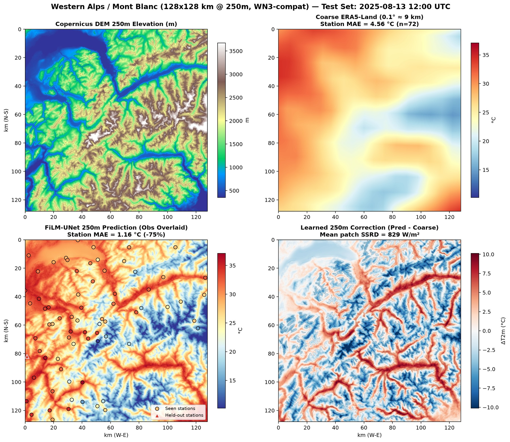
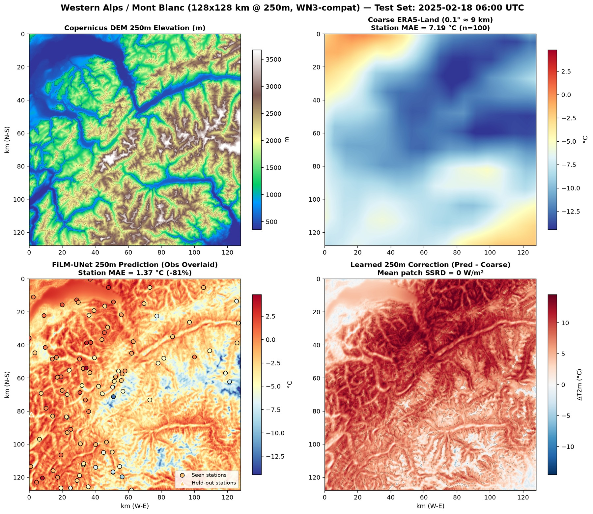
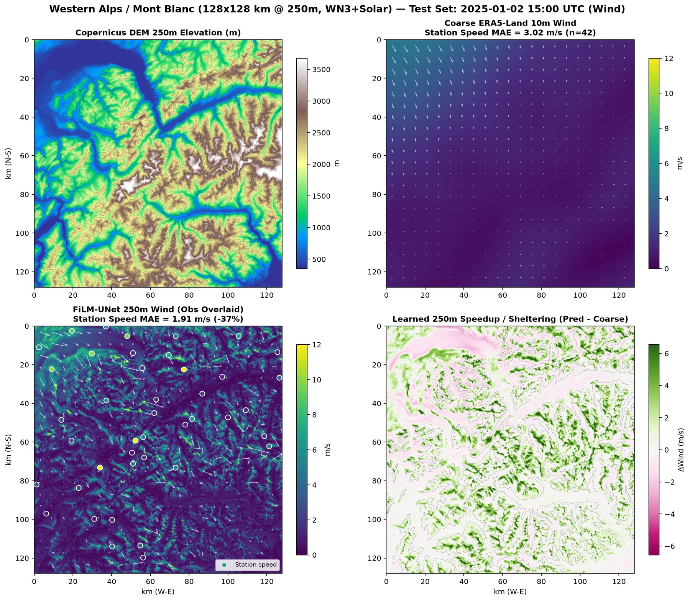
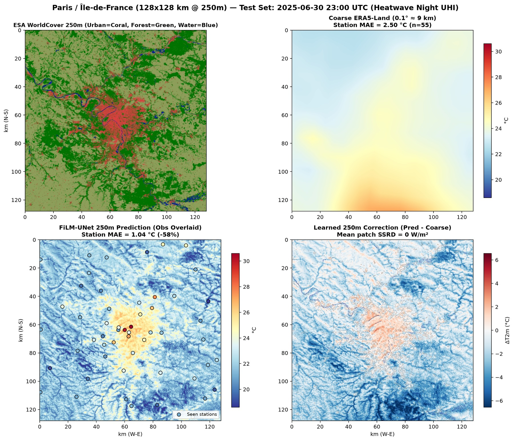
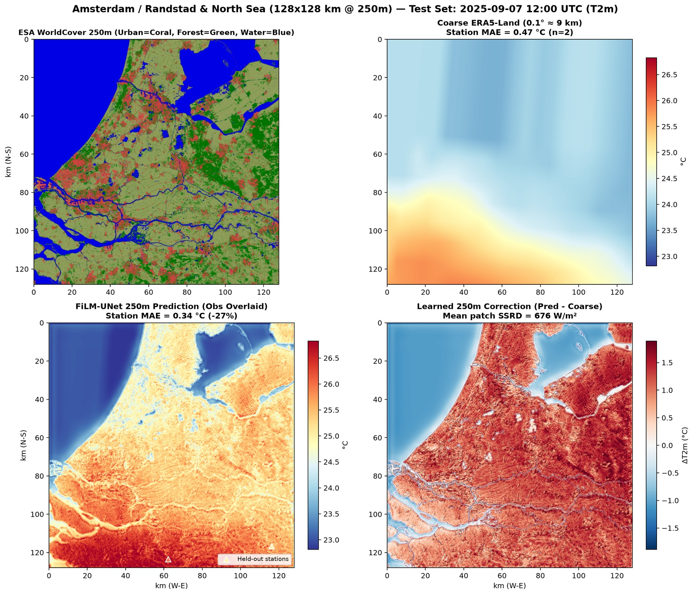

# RegionalNext

**250 m** resolution weather super-resolution dataset and **FiLM-conditioned Residual U-Net** over France, the Alps, the Pyrenees, and bordering Europe (`lat [41.0, 51.8]`, `lon [-5.5, 13.5]`, `EPSG:3035`).

Designed to downscale **`0.1°` (~9–10 km)** gridded forecasts (**ERA5-Land** during training; **Google WeatherNext 2/3** or **IFS** at inference) onto **250 m** terrain and land cover using **sparse weather station observations** as masked-loss targets.

- **Hugging Face Dataset:** [`meteolibre-dev/regionalnext`](https://huggingface.co/datasets/meteolibre-dev/regionalnext)
- **GitHub Repository:** [`meteolibre-dev/regionalnext`](https://github.com/meteolibre-dev/regionalnext)

---

## 1. Visual Results (2025 Held-Out Test Split)

All figures below are `128 km × 128 km` (`512 × 512` @ `250 m`) predictions on unseen **2025 `test` timestamps** using the WeatherNext-3-compatible `FiLMUNet` (`--wn3-compat --solar-film`). Ground-station observations are **never used as model inputs**—they are overlaid only as ground truth for evaluation.

### Western Alps / Mont Blanc — Summer Afternoon (`2025-08-13 12:00 UTC`)
Resolves sharp warm corridors along the Rhône/Valais, Arve/Chamonix, and Aosta valleys, cool Lake Geneva thermal contrast, and sub-zero glaciated peaks (`Station MAE: 4.56 °C → 1.16 °C`, **-75%**).



### Western Alps / Mont Blanc — Winter Morning (`2025-02-18 06:00 UTC`)
Corrects `ERA5-Land`'s severe coarse winter cold bias across valleys and mid-slopes while preserving freezing high-alpine ridges (`Station MAE: 7.19 °C → 1.37 °C`, **-81%**).



### Western Alps / Mont Blanc — Strong Alpine Wind (`2025-01-02 15:00 UTC`)
Learns orographic ridge speedup (`+4 to +6 m/s`) and valley sheltering (`Station Wind Speed MAE: 3.02 m/s → 1.91 m/s`, **-37%**).



### Paris / Île-de-France — Heatwave Night Urban Heat Island (`2025-06-30 23:00 UTC`)
Resolves the `+3 to +5 °C` urban core heat island over Paris/suburbs against cooler rural valleys and forests (`Boulogne`, `Vincennes`, `Fontainebleau`) (`Station MAE: 2.50 °C → 1.04 °C`, **-58%**).



### Amsterdam / Randstad & North Sea (`2025-09-07 12:00 UTC`)
Resolves the North Sea coastline, cool IJsselmeer water contrast, and warmer inland polders/urban Randstad (`Station MAE: 0.47 °C → 0.34 °C`, **-27%**).



---

## 2. Data Preprocessing Pipeline

### Domain & Metric Grid (`regionalnext/config.py`)
- **Projection:** `EPSG:3035` (ETRS89-extended / LAEA Europe) at exact **`250 m × 250 m`** pixel spacing (`ny = 5250`, `nx = 6382`).
- **Patch size:** `256 × 256` pixels (`64 km × 64 km`).

### Step 1 — Stratified Timestamp Sampling (`regionalnext/timestamps.py`)
- **2,880 timestamps** (`960` days across `2020–2025` × `3` diurnal bins/day):
  - `morning` (`04–08 UTC`, cold-air pooling / inversions)
  - `afternoon` (`12–16 UTC`, `Tmax` window)
  - `night` (`18–23 UTC`, evening cooling / urban heat island)
  - Excludes `00 UTC` so `ERA5-Land` solar radiation de-accumulation never wraps across midnight.
- **Temporal Splits (zero future leakage):**
  - `train` (`2020–2023`): **1,902** timestamps
  - `val` (`2024`): **489** timestamps
  - `test` (`2025`, overlapping WeatherNext 3 historical availability): **489** timestamps

### Step 2 — Multi-Source Ground Station Observations (`regionalnext/stations/`)
Ingests, quality-controls, and deduplicates collocated stations (`< 500 m` & `< 50 m` elevation difference, prioritizing national dense networks over METARs):
- **Météo-France** hourly open data (`meteo.data.gouv.fr`): **2,064** stations (up to `3,845 m`)
- **DWD CDC** (`opendata.dwd.de`): **341** stations (up to `2,956 m`)
- **MeteoSwiss OGD** (`data.geo.admin.ch`): **155** stations (up to `3,571 m`)
- **IEM ASOS/METAR** border stations (ES, IT, BE, LU, GB, AT, NL): **126** stations (up to `3,488 m`)
- **Total:** **2,686 stations** and **6,490,387 observations** (`6,426,788` `t2m_c`, `2,968,352` `u10/v10` wind).
- **Spatial Hold-out (`spatial_fold == 4`):** Stations are grouped into `64 km × 64 km` spatial blocks (`5` folds); fold `4` (~20% of stations) is **never supervised during `train`** and is evaluated separately as unseen station locations.

### Step 3 — Coarse Meteorological Inputs: `ERA5-Land` (`regionalnext/era5_land.py`)
- Downloads `0.1°` (~9 km) `reanalysis-era5-land` hourly fields from Copernicus CDS for every target hour `H` and `H - 1h`.
- De-accumulates `ssrd` into instantaneous hourly irradiance: `(ssrd(H) - ssrd(H-1)) / 3600` (`W/m²`).
- Fills ocean/coastal `NaN` cells via nearest-land distance transform (`distance_transform_edt`) so coastal interpolation never injects `NaN`s.
- Output: `data/processed/era5_land.zarr` (`(2880, 117, 199)`, `808 MB`, zero `NaN`s).

### Step 4 — 250 m Static Terrain & Land Cover (`regionalnext/static_250m.py`)
Reprojects and aggregates high-resolution static layers onto the `5250 × 6382` `250 m` `EPSG:3035` grid (`1.1 GB` Zarr):
- **Copernicus DEM GLO-90 (30–90 m → 250 m):** `elevation_m`, sub-pixel `elev_std_m`, `slope_deg`, `sin_aspect`, `cos_aspect`, multi-scale Topographic Position Index (`tpi_500m`, `tpi_2km`, `tpi_10km`), `dist_coast_km`, `land_mask`.
  - Verified against all `2,686` station barometer elevations: **median diff `0.77 m`**, **RMSE `18.7 m`**.
- **ESA WorldCover 2021 (10 m → 250 m class fractions):** `frac_tree`, `frac_grass_shrub`, `frac_crop`, `frac_urban`, `frac_bare_snow`, `frac_water`.

### Step 5 — Dataset Formats (`regionalnext/dataset.py`, `regionalnext/push_hf.py`)
1. **`full_grid/` (~1.95 GB, recommended):** `static_250m.zarr` + `era5_land.zarr` + `observations.parquet` + `stations.parquet` + `timestamps.parquet` + `norm_stats.json`.
   - `RegionalNextFullGridDataset` slices and bilinearly interpolates `256×256` patches on the fly (`~19 ms/patch`), yielding **664,999** non-overlapping active patches (`434,637` train / `115,164` val / `115,198` test) or **3,258,431** random-crop training anchors (`random_crop=True`).
2. **Pre-sliced curated subset (root, ~29 GB):** `patches_dense.zarr` `(5040, 256, 256, 27)` + COO `patches_sparse.parquet` (`55,095` target rows) loaded via `RegionalNextPatchDataset`.

---

## 3. Model & Training Recipe (`FiLMUNet`)

- **Architecture (`regionalnext/model.py`):** 4-level Residual U-Net (`[64, 128, 256, 512]`, `14.46M` params) with `GroupNorm`, `SiLU`, bilinear upsampling, and **FiLM (`gamma, beta`)** modulation in every residual block.
- **Residual Target:** Predicts `[ΔT2m, Δu10, Δv10]` added to bilinearly interpolated coarse `[t2m_c, u10_ms, v10_ms]` (`head` zero-initialized so training starts from the coarse baseline).
- **WeatherNext-3-Compatible Inputs (`--wn3-compat`):** Drops `sp_hpa` and `snow_depth_m` (not output by WeatherNext 3), keeping **21 spatial channels** (`t2m_c`, `d2m_c`, `u10_ms`, `v10_ms`, `ssrd_wm2` + 16 static 250 m layers).
- **Solar-Direction FiLM Conditioning (`--solar-film`, `regionalnext/solar.py`):** Uses vectorized `suncalc` solar position (`0.00e+00` diff vs `suncalc.get_position`) at each patch center to feed **10 scalar features** into FiLM:
  `[sin_hour, cos_hour, sin_doy, cos_doy, patch_mean_ssrd, sin(az), cos(az), sin(alt), sin(noon_alt), lat_norm]`.
- **Training (`regionalnext/train.py`):** Masked `SmoothL1(beta=1.0)` loss (`w_t2m=1.0, w_wind=0.5`), `AdamW`, cosine schedule with warmup, `bfloat16` AMP, `65,536` random-crop patches/epoch (`batch_size=64`), trained for `12 + 4` epochs on an NVIDIA RTX PRO 6000 Blackwell (`96 GB`).

---

## 4. Benchmark Results on 2025 `test` Split (`32,768` patches)

### All 2025 Test Stations (`315,852` `T2m` obs / `139,405` wind obs)
| Metric | Coarse `ERA5-Land` (`0.1°`) | `FiLMUNet` (`wn3_compat` + `solar_film`) | Improvement |
|---|---|---|---|
| `T2m` MAE (overall) | `1.7455 °C` | **`1.0755 °C`** | **-38.4%** |
| `T2m` RMSE (overall) | `2.4778 °C` | **`1.4695 °C`** | **-40.7%** |
| `T2m` MAE (`>= 1,000 m`) | `3.2699 °C` | **`1.2814 °C`** | **-60.8%** |
| `T2m` MAE (`>= 2,000 m`) | `3.8319 °C` | **`1.3360 °C`** | **-65.1%** |
| Wind speed MAE | `1.3404 m/s` | **`1.0613 m/s`** | **-20.8%** |
| Wind vector RMSE | `2.5782 m/s` | **`2.1327 m/s`** | **-17.3%** |

### Strictly Held-Out Stations (`spatial_fold == 4`, never seen in training — `130,339` `T2m` obs / `53,226` wind obs)
| Metric | Coarse `ERA5-Land` (`0.1°`) | `FiLMUNet` (`wn3_compat` + `solar_film`) | Improvement |
|---|---|---|---|
| `T2m` MAE (overall) | `1.6994 °C` | **`1.1705 °C`** | **-31.1%** |
| `T2m` RMSE (overall) | `2.3864 °C` | **`1.6032 °C`** | **-32.8%** |
| `T2m` MAE (`>= 1,000 m`) | `3.1045 °C` | **`1.4659 °C`** | **-52.8%** |
| `T2m` MAE (`>= 2,000 m`) | `4.1248 °C` | **`1.7641 °C`** | **-57.2%** |
| Wind speed MAE | `1.3537 m/s` | **`1.2775 m/s`** | **-5.6%** |
| Wind vector RMSE | `2.5746 m/s` | **`2.4999 m/s`** | **-2.9%** |

---

## 5. Quickstart

### Train Directly from Hugging Face (`1.95 GB`)
```bash
uv sync --extra train

# Train WN3-compatible + Solar-FiLM U-Net (auto-downloads full_grid/ from Hugging Face)
uv run python -m regionalnext.train \
  --hf-download \
  --data-dir data/hf_cache \
  --wn3-compat \
  --solar-film \
  --epochs 16 \
  --batch-size 64 \
  --train-samples-per-epoch 65536 \
  --out-dir runs/film_unet_wn3_solar

# Evaluate on full 2025 test split (overall + mountain + held-out stations)
uv run python -m regionalnext.train \
  --data-dir data/hf_cache \
  --resume runs/film_unet_wn3_solar/best.pt \
  --eval-only \
  --val-max-samples 0

# Generate 128x128 km regional maps (Paris, Alps, Amsterdam)
uv run python -m regionalnext.visualize \
  --data-dir data/hf_cache/full_grid \
  --ckpt runs/film_unet_wn3_solar/best.pt
```

### Reproduce Dataset Build from Scratch
```bash
uv sync
uv run python -m regionalnext.timestamps
uv run python -m regionalnext.stations.gather
uv run python -m regionalnext.era5_land --workers 2
uv run python -m regionalnext.static_250m
uv run python -m regionalnext.build_patches --n-patches 5000
uv run python -m regionalnext.push_hf --repo-id meteolibre-dev/regionalnext --mode both
```
